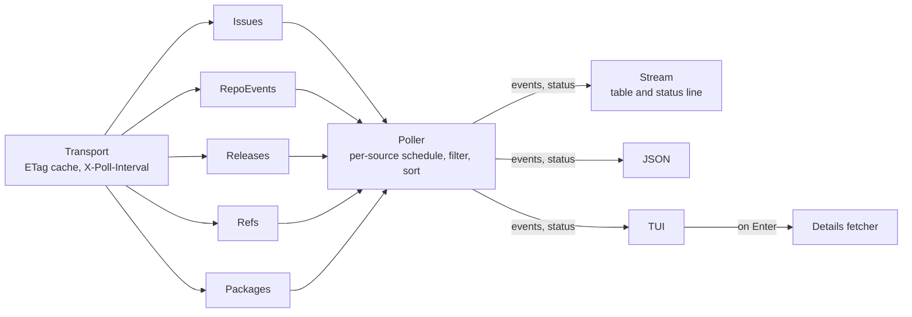

# gh-tail

A [gh](https://cli.github.com) extension that streams activity on a GitHub repository to the terminal: tags, branches, pull requests, issues, releases and packages.

```
$ gh tail -R cli/cli
TIME                 KIND     ACTION      ACTOR                 TEXT
2026-10-26 04:42:35  issue    opened      wdg-bots[bot]         #14821 x
2026-10-26 04:45:32  issue    closed      github-actions[bot]   #14821 x
2026-10-26 05:50:39  issue    opened      henrymodisett         #14822 gh run view --job --log-failed fails on required shared-workflow metadata 404
2026-10-26 10:47:56  pr       opened      Hrushikesh-ramilla    #14823 fix(issue create): print issue URL when post-creation mutations fail (#14367)
```

## Install

As a gh extension:

```sh
gh extension install KimNorgaard/gh-tail
gh tail
```

With Homebrew:

```sh
brew tap KimNorgaard/gh-tail https://github.com/KimNorgaard/gh-tail
brew install --cask gh-tail
gh-tail
```

The Homebrew cask installs a standalone `gh-tail` binary. gh does not discover extensions on `PATH`, so run it as `gh-tail`, not `gh tail`.

Authentication comes from gh. Run `gh auth login` first.

## Usage

```sh
gh tail                                  # current repository, default kinds
gh tail -R owner/repo                    # another repository
gh tail -R ghe.example.com/owner/repo    # GitHub Enterprise Server
gh tail --kinds tag,release,package      # choose kinds
gh tail --kinds pr:merged,issue:opened   # choose actions per kind
gh tail --kinds 'pr:*'                   # every PR action
gh tail --filter '-actor:*[bot]'         # hide bots
gh tail --filter 'author:@me label:bug'  # your PRs and issues labeled bug
gh tail --json | jq 'select(.kind == "tag")'
gh tail -i                               # interactive view with details
```

On start, gh-tail prints the last `-n` matching events, then polls and prints new events as they appear. Stop it with Ctrl-C.

In a terminal, rows are colored by kind and action, and PR and issue numbers are [OSC 8](https://gist.github.com/egmontkob/eb114294efbcd5adb1944c9f3cb5feda) links to GitHub (⌘-click in Ghostty, iTerm2 and most modern terminals). A status line below the rows shows when the next poll runs, how many requests were made and how many the ETag cache answered, and the last poll error. Piped output and `--json` stay plain.

### Interactive view

`gh tail -i` opens a full-screen list of events that follows new events as they arrive.

| Key | Action |
|-----|--------|
| `↑` `↓`, `k` `j`, mouse wheel | Move. Moving off the newest event stops following |
| `PgUp` `PgDn`, `b` `f` | Move a page |
| `g` `G` | First event, newest event. `G` follows again |
| `Enter`, click a selected row | Details |
| `o` | Open in the browser |
| `Esc`, `q` | Back from details |
| `q`, `Ctrl-C` | Quit |

Details are fetched when opened:

- **PR or issue:** state, author, labels, branches and size, and the rendered body
- **Release:** the release notes
- **Tag:** the commits since the previous semver tag

### Flags

| Flag | Default | Description |
|------|---------|-------------|
| `-R`, `--repo` | current repository | Repository as `[HOST/]OWNER/REPO` |
| `--kinds` | `tag,pr,issue` | Comma-separated `kind`, `kind:action` or `kind:*` entries. See below |
| `--filter` | none | Show only events matching these terms. See below |
| `--json` | off | Print one JSON object per line |
| `-i`, `--interactive` | off | Browse events and their details in a full-screen view |
| `--interval` | `1m` | Poll interval. Raised per endpoint to the server's `X-Poll-Interval`, which is 300 seconds for tags and branches |
| `-n` | `10` | Number of past events to show at startup |
| `--version` | | Print the version |

### Kinds

A bare kind selects its default actions. `kind:action` selects one action, and `kind:*` selects every action, including any GitHub adds later. Entries for the same kind add up, so `pr,pr:reopened` is the defaults plus `reopened`. An unknown kind or action is an error.

| Kind | Default actions | Other actions | Source |
|------|-----------------|---------------|--------|
| `tag` | `created` | `deleted` | Tag list, diffed between polls. The startup backlog comes from one GraphQL query |
| `branch` | `created`, `pushed` | `deleted` | Branch list, diffed between polls |
| `pr` | `opened`, `closed`, `merged` | `reopened`, `assigned`, `unassigned`, `labeled`, `unlabeled` | Issues list for the defaults. Events API for the others, plus one PR lookup per event for the title |
| `issue` | `opened`, `closed` | `reopened`, `assigned`, `unassigned`, `labeled`, `unlabeled` | Issues list for the defaults. Events API for the others |
| `release` | `published` | | Release list |
| `package` | `published` | | Packages API |

`closed` means closed without merging. For `labeled`, `unlabeled`, `assigned` and `unassigned`, the text ends with the label or `@assignee` in parentheses.

### Filters

`--filter` takes space-separated `key:value` terms.

| Key | Matches |
|-----|---------|
| `actor` | Who caused the event, such as the merger of a PR |
| `author` | Who opened the PR or issue, or published the release |
| `label` | Any of the PR's or issue's labels |

- `-key:value` excludes matching events
- `*` matches any run of characters, so `-actor:*[bot]` hides bots and `label:sig/*` matches every `sig/` label
- `@me` is the authenticated user
- Double quotes keep spaces in a value: `label:"good first issue"`
- Terms with the same key are ORed and different keys are ANDed, as in GitHub search: `author:ann author:bob label:bug` is "(ann or bob) and bug"
- Matching ignores case. An event without the field, such as a tag with no known actor, never matches a positive term

`--kinds` and `--filter` differ in cost. `--kinds` decides which APIs gh-tail polls. `--filter` only hides events after they are fetched.

### JSON output

Each event is one line:

```json
{"id":"pr:14823:opened:1793008076","time":"2026-10-26T09:47:56Z","repo":"cli/cli","kind":"pr","action":"opened","number":14823,"actor":"Hrushikesh-ramilla","text":"#14823 fix(issue create): print issue URL when post-creation mutations fail (#14367)","url":"https://github.com/cli/cli/pull/14823"}
```

| Field | Description |
|-------|-------------|
| `id` | Stable event ID, prefixed with its kind or source |
| `time` | When the event happened, RFC 3339. For a tag or branch change with no Events API entry yet, when gh-tail saw the change |
| `repo` | `owner/repo` |
| `kind` | One of the kinds above |
| `number` | PR or issue number, for `pr` and `issue` |
| `ref` | Tag or branch name, for `tag`, `branch` and `release` |
| `action` | What happened |
| `actor` | Login of the user who caused the event, when known |
| `author` | Login of the PR or issue author or the release publisher |
| `labels` | Labels of the PR or issue |
| `text` | Human-readable summary |
| `url` | Link to the PR, issue, release or package version, when known |

## Limitations

- **Delay for non-default PR and issue actions.** `reopened`, `assigned`, `labeled` and the like come from the [Events API](https://docs.github.com/en/rest/activity/events), which GitHub documents as not built for real-time use, with latency from 30 seconds to 6 hours depending on the time of day. Such an event prints with the time it happened, so it can appear below newer ones. Everything else comes from list endpoints and shows up on the next poll.
- **Tag and branch actors come from the Events API.** Refs have no actor or timestamp, so a ref change waits up to 3 polls for its Events API entry, which supplies both. If none arrives, the change prints without an actor and with the time gh-tail saw it. Tags that GitHub Apps create, such as Renovate's, get no Events API entry in the repositories checked so far.
- **Backlog tag times are approximate.** Git records no creation time for a tag, so the startup backlog uses the tagger date of an annotated tag and the commit date of a lightweight one.
- **Branches have no history.** The first poll only records the current branches, so branch events appear only for changes made while gh-tail runs.
- **Lookups.** Each new close or merge costs one request for its actor, and each PR event from the Events API one for its title. On startup, lookups stop once `-n` events pass the filter.
- **Labels are current, not historical.** An event carries the labels the PR or issue has when gh-tail fetches it.
- **Packages need `read:packages`.** Add the scope with `gh auth refresh -s read:packages`. Package polling costs 6 requests plus one per package linked to the repository.
- **Container noise is filtered.** Untagged versions and versions tagged only `sha256-<digest>` (signatures, attestations, per-platform manifests) are skipped.
- **No resume.** A restart shows the last `-n` events again.
- **Busy repositories.** One poll reads the 100 most recently updated issues and PRs and the latest 100 events. Changes beyond that between two polls are missed, as are list items that become visible more than 10 minutes after the newest one seen.

## How it works



- `internal/source`: each source polls one API and returns only events it has not returned before. `source.New` picks the sources the `--kinds` selection needs.
  - `Issues`: the issues list, sorted by update, which includes PRs. Derives `opened`, `closed` and `merged` from timestamps and looks up `closed_by` or `merged_by`
  - `RepoEvents`: the Events API, only for PR and issue actions the issues list can't show
  - `Releases`: the release list
  - `Refs`: `git/matching-refs/tags` or `heads`, diffed between polls. Each change is matched to its Events API entry for the actor
  - `Packages`: package versions of packages linked to the repository
- `internal/source/transport.go`: makes GET requests conditional with `If-None-Match`. GitHub does not count a `304 Not Modified` against the rate limit, so polling an idle repository is free. It records each source's `X-Poll-Interval` separately.
- `internal/poll`: schedules each source at its own interval, filters and sorts events, and reports events and status to a sink.
- `internal/event`: the normalized `Event`, the `--kinds` selection and the `--filter` query.
- `internal/output`: row styling shared with the TUI, the stream sink with its status line, and the JSON sink.
- `internal/tui`: the interactive view, built on Bubble Tea.
- `internal/details`: fetches a PR's or issue's body, release notes or a tag's commits as Markdown, rendered with gh's theme.
- `main.go`: flags and wiring.

## Development

Requires Go (version in `go.mod`), [just](https://github.com/casey/just), [golangci-lint](https://golangci-lint.run) and, for releases, [GoReleaser](https://goreleaser.com).

```sh
just build          # build ./gh-tail
just run -R cli/cli # build and run
just check          # fmt-check, lint, gosec, govulncheck, tests (what CI runs)
just snapshot       # build release artifacts and the cask into dist/
```

## Release

Push a `v*` tag. The release workflow runs GoReleaser, which:

- attaches `gh-tail_<os>_<arch>.tar.gz` archives for Homebrew
- attaches `gh-tail-<os>-<arch>` binaries for `gh extension install`
- pushes the updated cask to `Casks/gh-tail.rb` on a `cask/gh-tail-<version>` branch and opens a pull request against `main`

The repository is its own Homebrew tap. The release workflow's `GITHUB_TOKEN` opens the pull request, which needs **Settings → Actions → General → Allow GitHub Actions to create and approve pull requests**.

## License

MIT. See [LICENSE](LICENSE).
